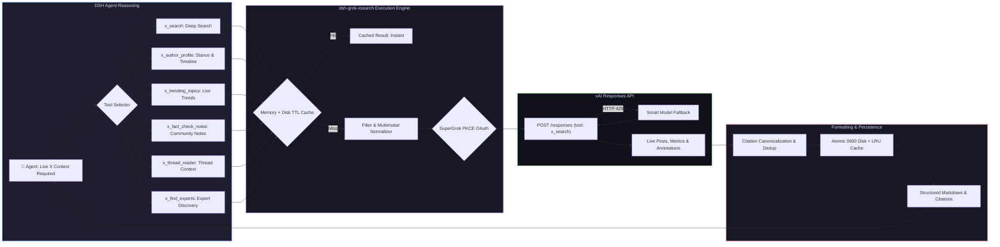

# 📦 @goodandready/dsh-grok-xsearch

<div align="center">

<h3>Real-Time X (Twitter) Intelligence & Search Tool Suite Powered by SuperGrok OAuth for DeepSeek Harness</h3>

<p align="center">
  <a href="https://www.npmjs.com/package/@goodandready/dsh-grok-xsearch"></a>
  <a href="LICENSE"></a>
  <a href="https://github.com/topics/dsh-plugin"></a>
  <a href="https://nodejs.org"></a>
</p>

<p align="center">
  <a href="https://goodandready.app/"></a>
</p>

<p align="center">
  <a href="README.md"><b>🇬🇧 English</b></a> •
  <a href="README.zh.md"><b>🇨🇳 中文说明</b></a> •
  <a href="README.ru.md"><b>🇷🇺 Русский</b></a>
</p>

<table align="center">
  <tr>
    <td align="center">
      ⭐ <strong>If you like this plugin, please star it on GitHub</strong> — it shows me that the plugin is useful to you and motivates me to keep developing it.
      <br><br>
      🐛 <strong>If you find a bug or would like to request a feature</strong>, open a GitHub issue in any language — I will review your proposal and implement useful suggestions in a future plugin version.
    </td>
  </tr>
</table>

</div>

---

## ⚡ Overview

**`dsh-grok-xsearch`** equips **DeepSeek Harness** agents with real-time X (Twitter) search, thread reconstruction, author profiling, trend discovery, and Community Notes verification.

By routing queries through an authenticated **SuperGrok OAuth** session to the official xAI Responses API (`POST /responses` with built-in `x_search`), agents gain live X intelligence without purchasing separate per-query X (Twitter) Enterprise/Pro API tiers (using your xAI SuperGrok subscription or xAI API credits instead).



---

## 🔑 Prerequisites

> [!IMPORTANT]
> Before connecting an account, make sure both requirements below are satisfied:

1. **xAI Account with SuperGrok or xAI API Credits**
   - The plugin calls `https://api.x.ai/v1/responses`, which requires an xAI account backed by an active **SuperGrok** subscription or **xAI API credits**.
   - **X Premium alone is not sufficient** — X Premium only grants Grok access inside `x.com`. With an X Premium-only account, OAuth sign-in succeeds and stores credentials, but every tool call is rejected upstream with:
     `You have run out of credits or need a Grok subscription.`
2. **OAuth Client ID (`grokClientId`) Matching the Callback Redirect URI**
   - You must supply an OAuth Client ID authorized for PKCE (`S256`) whose registered redirect URI covers `http://127.0.0.1:56121/callback` (or the custom `redirectUri` configured in **Advanced Settings**).
   - If the browser runs on another machine or does not redirect back automatically after sign-in, click **"Browser did not return here? Paste the redirected URL"** in the plugin settings card and submit the full callback URL from your browser's address bar.

---

## 🛠️ Complete Tool Suite Reference

The plugin registers **six** strict JSON-Schema tools in `ctx.tools`:

### 1. `x_search` — Deep Post & Thread Search

General-purpose natural-language search across X posts, threads, media, and engagement metrics.

| Parameter | Type | Required | Description |
|---|---|---|---|
| `query` | `string` | **Yes** | Natural-language search query or topic keywords |
| `allowed_x_handles` | `string` | No | Comma-separated `@handles` to include (up to 10; mutually exclusive with `excluded_x_handles`) |
| `excluded_x_handles` | `string` | No | Comma-separated `@handles` to exclude (up to 10) |
| `from_date` | `string` | No | Start date filter (`YYYY-MM-DD`, validated against future/inverted ranges) |
| `to_date` | `string` | No | End date filter (`YYYY-MM-DD`) |
| `only_original_posts` | `boolean` | No | Omit retweets and pure quote echoes |
| `has_media` | `boolean` | No | Filter for posts containing images, infographics, charts, or videos |
| `has_links` | `boolean` | No | Filter for posts containing external links, papers, or repositories |
| `only_threads` | `boolean` | No | Filter for extended multi-tweet discussion threads |
| `lang` | `string` | No | Language code filter (e.g. `en`, `zh`, `ru`, `ja`) |
| `min_likes` | `number` | No | Minimum likes threshold for signal filtering |
| `min_reposts` | `number` | No | Minimum reposts/retweets threshold |
| `enable_image_understanding` | `boolean` | No | Analyze and extract text/metrics from attached post images and charts |
| `enable_video_understanding` | `boolean` | No | Summarize statements, timestamps, and quotes from attached videos |
| `extract_tables` | `boolean` | No | Automatically enables image understanding and formats numerical benchmarks/charts into Markdown tables |

---

### 2. `x_author_profile` — Author Timeline & Position Analysis

| Parameter | Type | Required | Description |
|---|---|---|---|
| `handle` | `string` | **Yes** | Author's username (e.g. `@ylecun` or `sama`) |
| `focus_topic` | `string` | No | Specific topic or thesis to analyze the author's stance on |
| `from_date` | `string` | No | Start date filter (`YYYY-MM-DD`) |
| `to_date` | `string` | No | End date filter (`YYYY-MM-DD`) |
| `only_original_posts` | `boolean` | No | Focus on original author posts (default: `true`) |

---

### 3. `x_trending_topics` — Real-Time Trend Discovery

| Parameter | Type | Required | Description |
|---|---|---|---|
| `domain` | `string` | No | Topic domain (`tech`, `ai`, `crypto`, `science`, `finance`, default: `tech`) |
| `region` | `string` | No | Geographic focus (`Global`, `US`, `Europe`, `Asia`, default: `Global`) |
| `timeframe` | `string` | No | Period (`today`, `past_24h`, `past_week`, default: `today`) |
| `min_likes` | `number` | No | Minimum likes threshold for viral post detection (default: `20`) |

---

### 4. `x_fact_check_notes` — Community Notes & Fact-Checking

| Parameter | Type | Required | Description |
|---|---|---|---|
| `claim` | `string` | **Yes** | Statement or rumor to fact-check |
| `target_url` | `string` | No | Specific X post or article URL to verify |
| `allowed_x_handles` | `string` | No | Comma-separated researcher or institutional handles to check |
| `enable_image_understanding` | `boolean` | No | Inspect attached images or infographics in fact-checking posts |

---

### 5. `x_thread_reader` — Thread Reconstruction & Discussion Reader

| Parameter | Type | Required | Description |
|---|---|---|---|
| `tweet_url_or_id` | `string` | **Yes** | Tweet URL (`https://x.com/username/status/1234567890`) or numeric tweet ID |
| `include_replies` | `boolean` | No | Include notable community replies and expert rebuttals (default: `true`) |
| `max_depth` | `number` | No | Maximum thread depth to retrieve (default: `10`, clamped to `1–25`) |
| `extract_tables` | `boolean` | No | Format benchmarks, charts, and metrics from thread media into Markdown tables |

---

### 6. `x_find_experts` — Domain Expert & Key Opinion Leader Discovery

| Parameter | Type | Required | Description |
|---|---|---|---|
| `domain_or_topic` | `string` | **Yes** | Domain, research field, technology, or topic (e.g. `Rust async`, `distributed LLM training`) |
| `min_followers` | `number` | No | Optional minimum followers threshold |
| `language` | `string` | No | Language focus code (e.g. `en`, `zh`) |
| `limit` | `number` | No | Number of expert profiles to return (default: `5`, clamped to `1–15`) |

---

## 🛡️ Architecture, Resilience & Security

* **Credential Seam & Single-Flight OAuth Refresh (`lib/token-manager.js`, `lib/grok-oauth.js`)**: OAuth tokens are stored exclusively in DSH `ctx.credentials` under plain `CredentialRef` `GROK_XSEARCH_OAUTH_1` (never in plain settings). Concurrent refresh triggers share a single in-flight promise, `HTTP 401` responses trigger automatic single-retry token recovery (even when `retries` is `0`), and fatal `invalid_grant` responses evict broken credentials automatically.
* **Smart Rate-Limit Fallback & Backoff (`lib/xsearch.js`)**: On `HTTP 429`, queries automatically fall back across compatible Grok reasoning models; transient network and `5xx` errors retry with bounded exponential backoff.
* **Account-Isolated Memory & `0600` Disk Cache (`lib/xsearch.js`)**: Recent responses are cached per account fingerprint (SHA-256 of access token) in a bounded 200-entry LRU map backed by atomic profile-scoped disk persistence (`0600` permissions) flushed cleanly on plugin reload/shutdown.
* **Citation Canonicalization**: Normalizes `twitter.com` links to `https://x.com/<handle>/status/<id>`, strips tracking parameters (`s`, `t`, `ref_src`, `utm_*`), and deduplicates inline and top-level citations.
* **Fail-Closed Route & SSRF Protection (`lib/http.js`, `lib/updater.js`)**: All settings and OAuth routes enforce `ctx.connection.requestRejection` plus same-origin/loopback verification. `baseUrl` is strictly restricted to `https://api.x.ai` (or local loopback for testing), preventing bearer token leakage to untrusted hosts.
* **Native Multi-Language Settings Card & One-Click Updater (`lib/client.js`, `lib/updater.js`)**: Mounted on DSH plugin seats (`plugins.row.config` and `plugins.item`) with canonical `--dsw-alias-*` theme tokens, `ErrorBoundary` isolation, live cache hit-rate meter, one-click npm updater, built-in English (`en`) and Chinese (`zh`) locales, and runtime Russian translation support via `@goodandready/dsh-russian-lang`.

---

## ⚙️ Configuration (`settings.yaml` / Web UI)

```yaml
dsh-grok-xsearch:
  enabled: true
  grokClientId: "<YOUR_GROK_OAUTH_CLIENT_ID>"
  redirectUri: "http://127.0.0.1:56121/callback"
  baseUrl: "https://api.x.ai/v1"
  model: "grok-4.6"
  timeoutSeconds: 180
  retries: 2
  autoFallbackModel: true
  enableCache: true
  cacheTtlSeconds: 300
```

| Parameter | Type | Default | Description |
|---|---|---|---|
| `enabled` | `boolean` | `true` | Enables or disables registration of all six Grok X tools |
| `grokClientId` | `string` | `""` | OAuth Client ID for PKCE sign-in (must allow `redirectUri`) |
| `redirectUri` | `string` | `"http://127.0.0.1:56121/callback"` | Local OAuth PKCE callback URL |
| `baseUrl` | `string` | `"https://api.x.ai/v1"` | Upstream xAI API root (`https://api.x.ai` or local loopback only) |
| `model` | `string` | `"grok-4.6"` | Default xAI model for Responses queries |
| `timeoutSeconds` | `number` | `180` | Request timeout in seconds (`5–900`) |
| `retries` | `number` | `2` | Retry attempts on transient network / `5xx` errors (`0–10`) |
| `autoFallbackModel` | `boolean` | `true` | Automatically switch to fallback models on `HTTP 429` |
| `enableCache` | `boolean` | `true` | Enable account-isolated memory + disk response cache |
| `cacheTtlSeconds` | `number` | `300` | Cache retention TTL in seconds (`10–86400`) |

---

## 📦 Quick Installation

```bash
dsh plugin --profile web add @goodandready/dsh-grok-xsearch
```

After installation, open **Settings → Plugins → Grok X Search & Intelligence Suite**, enter your `grokClientId`, and click **Connect**.

---

## 🔌 HTTP API Routes

| Route | Method | Description |
|---|---|---|
| `/dsh-grok-xsearch/config` | `GET, PUT` | Reads or updates plugin configuration, account status, model catalog, and cache telemetry |
| `/dsh-grok-xsearch/cache/clear` | `POST` | Purges in-memory + disk query cache and cached models catalog |
| `/dsh-grok-xsearch/oauth/start` | `GET` | Generates PKCE challenge (`S256`) and returns xAI OAuth authorization URL |
| `/dsh-grok-xsearch/oauth/callback` | `GET` | Handles browser OAuth redirect callback (`code`/`state` or provider errors) |
| `/dsh-grok-xsearch/oauth/complete` | `POST` | Completes PKCE sign-in from a manually pasted callback URL or authorization code |
| `/dsh-grok-xsearch/logout` | `POST` | Removes stored credential from `ctx.credentials` and flushes pending OAuth, cache, and mutex state |
| `/api/dsh-grok-xsearch/update` | `GET, HEAD, POST` | Checks installed vs. latest npm version (`GET`) or performs a guarded one-click exact update (`POST`) |

---

## 🩺 Troubleshooting

- **`You have run out of credits or need a Grok subscription`**: Your OAuth login succeeded, but the connected xAI account only has standard X / X Premium without **SuperGrok** or **xAI API credits**. Activate SuperGrok or add xAI API credits on that account.
- **Browser does not return after sign-in**: Copy the full redirected callback URL (`http://127.0.0.1:56121/callback?code=...&state=...`) from the browser address bar, click **"Browser did not return here? Paste the redirected URL"** in the plugin card, and click **Submit**.
- **`untrusted baseUrl host`**: For security, `baseUrl` only accepts `https://api.x.ai` (and subdomains) or local loopback (`127.0.0.1` / `localhost`).

---

## 📄 License

MIT © [GooDAnDReaDY](https://github.com/GooDAnDReaDY)
