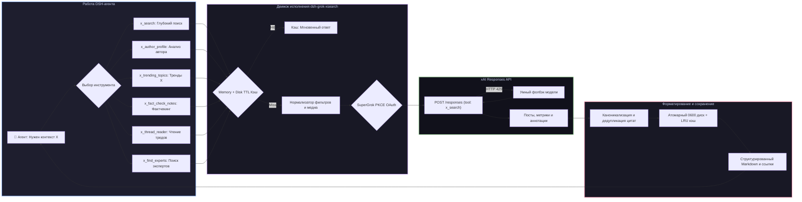

# 📦 @goodandready/dsh-grok-xsearch

<div align="center">

<h3>Интеллектуальный комплекс поиска и анализа X (Twitter) на базе SuperGrok OAuth для DeepSeek Harness</h3>

<p align="center">
  <a href="https://www.npmjs.com/package/@goodandready/dsh-grok-xsearch"></a>
  <a href="LICENSE"></a>
  <a href="https://github.com/topics/dsh-plugin"></a>
  <a href="https://nodejs.org"></a>
</p>

<p align="center">
  <a href="https://goodandready.app/"></a>
</p>

<p align="center">
  <a href="README.md"><b>🇬🇧 English</b></a> •
  <a href="README.zh.md"><b>🇨🇳 中文说明</b></a> •
  <a href="README.ru.md"><b>🇷🇺 Русский</b></a>
</p>

<table align="center">
  <tr>
    <td align="center">
      ⭐ <strong>Если вам нравится этот плагин, поставьте ему Star на GitHub</strong> — это покажет мне, что плагин полезен, и добавит мотивации продолжать его развитие.
      <br><br>
      🐛 <strong>Если вы нашли баг или хотите предложить новую функцию</strong>, создайте Issue на GitHub на любом языке — я рассмотрю предложение и реализую полезные улучшения в одной из следующих версий плагина.
    </td>
  </tr>
</table>

</div>

---

## ⚡ Обзор возможностей

**`dsh-grok-xsearch`** предоставляет агентам **DeepSeek Harness** набор из шести специализированных аналитических инструментов для глубокого поиска, реконструкции тредов, анализа авторов, мониторинга трендов и проверки фактов в **X (Twitter)** в реальном времени.

Используя авторизованную сессию **SuperGrok OAuth** и официальный xAI Responses API (`POST /responses` со встроенным инструментом `x_search`), плагин не требует дорогостоящих тарифов X (Twitter) Enterprise/Pro API (используется ваша подписка SuperGrok или кредиты xAI API).



---

## 🔑 Предварительные требования (Prerequisites)

> [!IMPORTANT]
> Перед подключением аккаунта убедитесь, что выполнены оба требования:

1. **Аккаунт xAI с подпиской SuperGrok или API-кредитами xAI**
   - Плагин обращается к `https://api.x.ai/v1/responses`, для работы которого необходим аккаунт xAI с активной подпиской **SuperGrok** или пополненным балансом **кредитов xAI API**.
   - **Одной подписки X Premium недостаточно** — X Premium открывает доступ к Grok только внутри веб-интерфейса `x.com`. На аккаунте только с X Premium вход по OAuth пройдёт успешно, но каждый вызов инструмента вернёт ошибку:
     `You have run out of credits or need a Grok subscription.`
2. **OAuth Client ID (`grokClientId`) с поддержкой локального Redirect URI**
   - Необходим OAuth Client ID с поддержкой PKCE (`S256`), для которого разрешён локальный адрес перенаправления `http://127.0.0.1:56121/callback` (либо свой `redirectUri`, заданный в разделе **Расширенные настройки**).
   - Если браузер открыт на другой машине или не перенаправил обратно автоматически после входа, нажмите **«Браузер не вернулся автоматически? Вставьте URL перенаправления»** в карточке плагина и отправьте полный URL из адресной строки браузера.

---

## 🛠️ Справочник инструментов

Плагин регистрирует **6** специализированных инструментов со строгой JSON Schema в `ctx.tools`:

### 1. `x_search` — Глубокий поиск постов и тредов

| Параметр | Тип | Обязательный | Описание |
|---|---|---|---|
| `query` | `string` | **Да** | Поисковый запрос на естественном языке |
| `allowed_x_handles` | `string` | Нет | Включаемые авторы через запятую (`@handle`, до 10; несовместимо с `excluded_x_handles`) |
| `excluded_x_handles` | `string` | Нет | Исключаемые авторы через запятую (до 10) |
| `from_date` | `string` | Нет | Начальная дата диапазона (`YYYY-MM-DD`) |
| `to_date` | `string` | Нет | Конечная дата диапазона (`YYYY-MM-DD`) |
| `only_original_posts` | `boolean` | Нет | Исключать репосты и чистые цитаты |
| `has_media` | `boolean` | Нет | Искать только посты с изображениями, графиками или видео |
| `has_links` | `boolean` | Нет | Искать только посты со ссылками на статьи, работы или репозитории |
| `only_threads` | `boolean` | Нет | Искать развёрнутые многотвитные авторские треды |
| `lang` | `string` | Нет | Код языка публикаций (например, `ru`, `en`, `zh`, `ja`) |
| `min_likes` | `number` | Нет | Минимальный порог лайков |
| `min_reposts` | `number` | Нет | Минимальный порог репостов/ретвитов |
| `enable_image_understanding` | `boolean` | Нет | Анализ и извлечение данных из прикреплённых изображений и графиков |
| `enable_video_understanding` | `boolean` | Нет | Сводка высказываний, таймкодов и цитат из видеороликов |
| `extract_tables` | `boolean` | Нет | Автоматически включает анализ изображений и форматирует таблицы/бенчмарки из медиа в Markdown-таблицы |

---

### 2. `x_author_profile` — Анализ профиля и тезисов автора

| Параметр | Тип | Обязательный | Описание |
|---|---|---|---|
| `handle` | `string` | **Да** | Имя пользователя в X (например, `@ylecun` или `sama`) |
| `focus_topic` | `string` | Нет | Конкретная тема или вопрос для анализа позиции автора |
| `from_date` | `string` | Нет | Начальная дата диапазона (`YYYY-MM-DD`) |
| `to_date` | `string` | Нет | Конечная дата диапазона (`YYYY-MM-DD`) |
| `only_original_posts` | `boolean` | Нет | Только оригинальные посты автора (по умолчанию `true`) |

---

### 3. `x_trending_topics` — Поиск горячих трендов в реальном времени

| Параметр | Тип | Обязательный | Описание |
|---|---|---|---|
| `domain` | `string` | Нет | Домен темы (`tech`, `ai`, `crypto`, `science`, `finance`, по умолчанию `tech`) |
| `region` | `string` | Нет | Географический фокус (`Global`, `US`, `Europe`, `Asia`, по умолчанию `Global`) |
| `timeframe` | `string` | Нет | Период (`today`, `past_24h`, `past_week`, по умолчанию `today`) |
| `min_likes` | `number` | Нет | Порог лайков для фильтрации вирусных постов (по умолчанию `20`) |

---

### 4. `x_fact_check_notes` — Проверка фактов и Community Notes

| Параметр | Тип | Обязательный | Описание |
|---|---|---|---|
| `claim` | `string` | **Да** | Утверждение, новость или слух для проверки |
| `target_url` | `string` | Нет | Ссылка на конкретный пост или статью для верификации |
| `allowed_x_handles` | `string` | Нет | Аккаунты исследователей или организаций через запятую |
| `enable_image_understanding` | `boolean` | Нет | Анализ инфографики и скриншотов в постах с проверкой фактов |

---

### 5. `x_thread_reader` — Реконструкция тредов и цепочек твитов

| Параметр | Тип | Обязательный | Описание |
|---|---|---|---|
| `tweet_url_or_id` | `string` | **Да** | URL твита (`https://x.com/username/status/1234567890`) или числовой ID |
| `include_replies` | `boolean` | Нет | Включать заметные ответы сообщества и экспертные реплики (по умолчанию `true`) |
| `max_depth` | `number` | Нет | Максимальная глубина треда (по умолчанию `10`, диапазон `1–25`) |
| `extract_tables` | `boolean` | Нет | Форматировать таблицы, графики и бенчмарки из медиа в Markdown-таблицы |

---

### 6. `x_find_experts` — Поиск профильных экспертов и лидеров мнений

| Параметр | Тип | Обязательный | Описание |
|---|---|---|---|
| `domain_or_topic` | `string` | **Да** | Предметная область, тема или технология (например, `Rust async`, `LLM reasoning`) |
| `min_followers` | `number` | Нет | Минимальное число подписчиков |
| `language` | `string` | Нет | Код языка публикаций (например, `en`, `ru`, `zh`) |
| `limit` | `number` | Нет | Количество профилей экспертов (по умолчанию `5`, диапазон `1–15`) |

---

## 🛡️ Архитектура, отказоустойчивость и безопасность

* **Изоляция токенов и Single-Flight OAuth Mutex (`lib/token-manager.js`, `lib/grok-oauth.js`)**: OAuth-сессия хранится в сервисе `ctx.credentials` по строковому ключу `GROK_XSEARCH_OAUTH_1` (секреты никогда не попадают в настройки). Параллельные запросы делят общий промис обновления токена; при `HTTP 401` выполняется автоматический рефреш и повтор запроса (даже при `retries: 0`), а при фатальном `invalid_grant` битый токен автоматически очищается.
* **Умный фолбэк моделей и экспоненциальный backoff (`lib/xsearch.js`)**: При `HTTP 429` движок автоматически переключается на резервные модели Grok; временные сетевые ошибки и `5xx` повторяются с экспоненциальной паузой.
* **Изолированный LRU-кэш в памяти и `0600` кэш на диске (`lib/xsearch.js`)**: Ответы кэшируются с привязкой к отпечатку аккаунта (до 200 записей) и атомарно сохраняются на диск с правами `0600` и суффиксом профиля DSH, гарантированно сбрасываясь на диск при остановке или перезагрузке плагина.
* **Каноникализация цитат**: Ссылки `twitter.com` приводятся к `https://x.com/<handle>/status/<id>`, очищаются от трекинг-параметров (`s`, `t`, `ref_src`, `utm_*`) и дедуплицируются.
* **Fail-Closed защита маршрутов и защита от SSRF (`lib/http.js`, `lib/updater.js`)**: Все маршруты настроек и OAuth проверяют `ctx.connection.requestRejection` и доверенный same-origin/loopback источник; `baseUrl` ограничен `https://api.x.ai` и локальным loopback, что исключает утечку Bearer-токена на сторонние хосты.
* **Нативная карточка настроек и автообновление в один клик (`lib/client.js`, `lib/updater.js`)**: Карточка встроена в слоты `plugins.row.config` и `plugins.item` на канонических токенах `--dsw-alias-*`, защищена `ErrorBoundary`, содержит индикатор заполнения кэша, блок обновления из npm и словари `en` + `zh` (русский интерфейс обеспечивается на лету плагином `@goodandready/dsh-russian-lang`).

---

## ⚙️ Конфигурация (`settings.yaml` / Web UI)

```yaml
dsh-grok-xsearch:
  enabled: true
  grokClientId: "<YOUR_GROK_OAUTH_CLIENT_ID>"
  redirectUri: "http://127.0.0.1:56121/callback"
  baseUrl: "https://api.x.ai/v1"
  model: "grok-4.6"
  timeoutSeconds: 180
  retries: 2
  autoFallbackModel: true
  enableCache: true
  cacheTtlSeconds: 300
```

| Параметр | Тип | По умолчанию | Описание |
|---|---|---|---|
| `enabled` | `boolean` | `true` | Включение или отключение всех 6 инструментов плагина |
| `grokClientId` | `string` | `""` | OAuth Client ID для PKCE-авторизации (должен разрешать `redirectUri`) |
| `redirectUri` | `string` | `"http://127.0.0.1:56121/callback"` | Локальный URL обратного вызова OAuth PKCE |
| `baseUrl` | `string` | `"https://api.x.ai/v1"` | Базовый URL API xAI (разрешены только `https://api.x.ai` и локальный loopback) |
| `model` | `string` | `"grok-4.6"` | Модель Grok по умолчанию для синтеза ответов |
| `timeoutSeconds` | `number` | `180` | Таймаут выполнения запроса в секундах (`5–900`) |
| `retries` | `number` | `2` | Число повторов при временных сетевых сбоях и `5xx` (`0–10`) |
| `autoFallbackModel` | `boolean` | `true` | Автоматический переход на резервную модель при `HTTP 429` |
| `enableCache` | `boolean` | `true` | Кэширование ответов в памяти и на диске с изоляцией по аккаунту |
| `cacheTtlSeconds` | `number` | `300` | Время жизни записей кэша в секундах (`10–86400`) |

---

## 📦 Быстрая установка

```bash
dsh plugin --profile web add @goodandready/dsh-grok-xsearch
```

После установки откройте **Настройки → Плагины → Grok X Search & Intelligence Suite**, укажите `grokClientId` и нажмите **Подключить**.

---

## 🔌 HTTP API Маршруты

| Маршрут | Метод | Описание |
|---|---|---|
| `/dsh-grok-xsearch/config` | `GET, PUT` | Чтение и сохранение настроек, статуса аккаунта, списка моделей и метрик кэша |
| `/dsh-grok-xsearch/cache/clear` | `POST` | Очистка кэша поисковых запросов (память + диск) и кэша моделей |
| `/dsh-grok-xsearch/oauth/start` | `GET` | Генерация PKCE (`S256`) и получение ссылки авторизации xAI |
| `/dsh-grok-xsearch/oauth/callback` | `GET` | Приём браузерного редиректа OAuth (`code`/`state` и ошибок провайдера) |
| `/dsh-grok-xsearch/oauth/complete` | `POST` | Завершение входа по вручную вставленному URL перенаправления или коду |
| `/dsh-grok-xsearch/logout` | `POST` | Удаление токена из `ctx.credentials`, сброс незавершённых сессий, кэша и мьютекса |
| `/api/dsh-grok-xsearch/update` | `GET, HEAD, POST` | Проверка текущей и последней версии в npm (`GET`) и безопасное обновление в один клик (`POST`) |

---

## 🩺 Диагностика и частые вопросы

- **`You have run out of credits or need a Grok subscription`**: Авторизация OAuth прошла, но на подключённом аккаунте есть только обычный X / X Premium без **SuperGrok** и без **кредитов xAI API**. Подключите SuperGrok или пополните баланс кредитов xAI API.
- **Браузер не вернулся в настройки после входа**: Скопируйте полный URL редиректа (`http://127.0.0.1:56121/callback?code=...&state=...`) из адресной строки браузера, нажмите **«Браузер не вернулся автоматически? Вставьте URL перенаправления»** в карточке плагина и нажмите **Отправить**.
- **`untrusted baseUrl host`**: В целях защиты от утечки токенов `baseUrl` принимает только `https://api.x.ai` (и поддомены) либо локальный loopback (`127.0.0.1` / `localhost`).

---

## 📄 Лицензия

MIT © [GooDAnDReaDY](https://github.com/GooDAnDReaDY)
