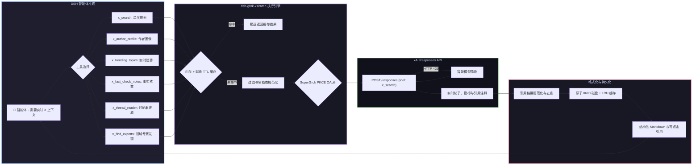

# 📦 @goodandready/dsh-grok-xsearch

<div align="center">

<h3>基于 SuperGrok OAuth 的 DeepSeek Harness 实时 X (Twitter) 搜索与情报套件</h3>

<p align="center">
  <a href="https://www.npmjs.com/package/@goodandready/dsh-grok-xsearch"></a>
  <a href="LICENSE"></a>
  <a href="https://github.com/topics/dsh-plugin"></a>
  <a href="https://nodejs.org"></a>
</p>

<p align="center">
  <a href="https://goodandready.app/"></a>
</p>

<p align="center">
  <a href="README.md"><b>🇬🇧 English</b></a> •
  <a href="README.zh.md"><b>🇨🇳 中文说明</b></a> •
  <a href="README.ru.md"><b>🇷🇺 Русский</b></a>
</p>

<table align="center">
  <tr>
    <td align="center">
      ⭐ <strong>如果您喜欢这个插件，请在 GitHub 上为它点亮 Star</strong> — 这能让我知道插件对您有用，并鼓励我继续开发和维护它。
      <br><br>
      🐛 <strong>如果您发现 Bug 或希望增加功能</strong>，请使用任意语言在 GitHub 上提交 Issue — 我会评估您的建议，并在后续版本中实现有价值的改进。
    </td>
  </tr>
</table>

</div>

---

## ⚡ 概述

**`dsh-grok-xsearch`** 为 **DeepSeek Harness** 智能体提供一整套实时 X (Twitter) 深度搜索、长帖讨论串还原、作者画像分析、趋势挖掘与社区附注 (Community Notes) 事实核查工具。

插件通过经过验证的 **SuperGrok OAuth** 会话调用官方 xAI Responses API (`POST /responses` 内置 `x_search`)，无需单独购买昂贵的 X (Twitter) Enterprise/Pro API 套餐（仅需您的 xAI SuperGrok 订阅或 xAI API 额度）。



---

## 🔑 前置要求 (Prerequisites)

> [!IMPORTANT]
> 在连接账户前，请确保满足以下两项条件：

1. **具备 SuperGrok 订阅或 xAI API 额度的 xAI 账户**
   - 本插件调用 `https://api.x.ai/v1/responses`，需要账户拥有有效的 **SuperGrok** 订阅或 **xAI API 额度 (credits)**。
   - **仅有 X Premium 订阅是不够的** —— X Premium 仅提供 `x.com` 站内的 Grok 使用权限。若账户仅有 X Premium，OAuth 登录可以成功保存凭据，但所有工具调用都会返回上游错误：
     `You have run out of credits or need a Grok subscription.`
2. **支持本地回调地址的 OAuth Client ID (`grokClientId`)**
   - 需要填写支持 PKCE (`S256`) 且允许回调地址覆盖 `http://127.0.0.1:56121/callback`（或在**高级设置**中自定义的 `redirectUri`）的 OAuth Client ID。
   - 如果浏览器运行在远程机器上或登录后未能自动跳回，可在插件设置卡片中点击 **“浏览器未自动返回？粘贴重定向 URL”**，粘贴浏览器地址栏中的完整回调链接完成绑定。

---

## 🛠️ 工具集完整参考

插件在 `ctx.tools` 中注册了 **6 个**严格遵循 JSON Schema 契约的工具：

### 1. `x_search` — 帖子与讨论深度搜索

| 参数 | 类型 | 必填 | 说明 |
|---|---|---|---|
| `query` | `string` | **是** | 自然语言搜索词或主题关键词 |
| `allowed_x_handles` | `string` | 否 | 仅包含指定作者用户名（逗号分隔，最多 10 个，不可与 `excluded_x_handles` 同时使用） |
| `excluded_x_handles` | `string` | 否 | 排除指定作者用户名（逗号分隔，最多 10 个） |
| `from_date` | `string` | 否 | 起始日期 (`YYYY-MM-DD`) |
| `to_date` | `string` | 否 | 结束日期 (`YYYY-MM-DD`) |
| `only_original_posts` | `boolean` | 否 | 仅限原创帖子（过滤转推与纯引用） |
| `has_media` | `boolean` | 否 | 仅筛选包含图片、信息图、图表或视频的帖子 |
| `has_links` | `boolean` | 否 | 仅筛选包含外部链接、论文或代码仓库的帖子 |
| `only_threads` | `boolean` | 否 | 仅筛选多条连发深度讨论串 |
| `lang` | `string` | 否 | 语言代码过滤 (例如 `en`, `zh`, `ru`, `ja`) |
| `min_likes` | `number` | 否 | 最低点赞数门槛 |
| `min_reposts` | `number` | 否 | 最低转发数门槛 |
| `enable_image_understanding` | `boolean` | 否 | 允许 xAI 分析并提取帖子配图和图表中的数据 |
| `enable_video_understanding` | `boolean` | 否 | 允许 xAI 总结帖子视频片段中的发言与关键帧 |
| `extract_tables` | `boolean` | 否 | 自动开启图像理解并将配图中的基准测试、财务指标或对比数据整理为 Markdown 表格 |

---

### 2. `x_author_profile` — 作者观点与时间线分析

| 参数 | 类型 | 必填 | 说明 |
|---|---|---|---|
| `handle` | `string` | **是** | 作者 X 用户名（如 `@ylecun` 或 `sama`） |
| `focus_topic` | `string` | 否 | 重点分析该作者在特定议题上的立场 |
| `from_date` | `string` | 否 | 起始日期 (`YYYY-MM-DD`) |
| `to_date` | `string` | 否 | 结束日期 (`YYYY-MM-DD`) |
| `only_original_posts` | `boolean` | 否 | 仅分析原创帖（默认 `true`） |

---

### 3. `x_trending_topics` — 实时热门趋势挖掘

| 参数 | 类型 | 必填 | 说明 |
|---|---|---|---|
| `domain` | `string` | 否 | 领域分类（如 `tech`, `ai`, `crypto`, `science`, `finance`，默认 `tech`） |
| `region` | `string` | 否 | 地区范围（如 `Global`, `US`, `Europe`, `Asia`，默认 `Global`） |
| `timeframe` | `string` | 否 | 时间范围（`today`, `past_24h`, `past_week`，默认 `today`） |
| `min_likes` | `number` | 否 | 热门帖子最低点赞门槛（默认 `20`） |

---

### 4. `x_fact_check_notes` — 社区附注与事实核查

| 参数 | 类型 | 必填 | 说明 |
|---|---|---|---|
| `claim` | `string` | **是** | 待核查的陈述、新闻或传闻 |
| `target_url` | `string` | 否 | 待核实的指定推文或文章 URL |
| `allowed_x_handles` | `string` | 否 | 限定核查的研究者或权威机构账号（逗号分隔） |
| `enable_image_understanding` | `boolean` | 否 | 检查辟谣帖中的配图或信息图 |

---

### 5. `x_thread_reader` — 长推文讨论串深度还原

| 参数 | 类型 | 必填 | 说明 |
|---|---|---|---|
| `tweet_url_or_id` | `string` | **是** | 推文 URL（如 `https://x.com/username/status/1234567890`）或纯数字 ID |
| `include_replies` | `boolean` | 否 | 是否包含高互动优质社区回复与反驳（默认 `true`） |
| `max_depth` | `number` | 否 | 讨论串最大抓取深度（默认 `10`，范围 `1–25`） |
| `extract_tables` | `boolean` | 否 | 将讨论串配图中的图表与基准数据整理为 Markdown 表格 |

---

### 6. `x_find_experts` — 领域权威专家与意见领袖发现

| 参数 | 类型 | 必填 | 说明 |
|---|---|---|---|
| `domain_or_topic` | `string` | **是** | 研究领域、技术栈或核心议题（如 `Rust async`、`LLM 推理`） |
| `min_followers` | `number` | 否 | 最低关注者数量门槛 |
| `language` | `string` | 否 | 语言代码（如 `en`, `zh`） |
| `limit` | `number` | 否 | 返回专家数量（默认 `5`，范围 `1–15`） |

---

## 🛡️ 架构、容错与安全特性

* **安全凭据隔离与单飞刷新互斥锁 (`lib/token-manager.js`)**：OAuth 令牌通过纯字符串引用 `GROK_XSEARCH_OAUTH_1` 安全保存在 DSH `ctx.credentials` 服务中（绝不写入明文配置）。并发刷新共享同一 Promise；遇到 `HTTP 401` 时自动强制刷新并重试（即使 `retries` 设为 `0`）；遇到不可恢复的 `invalid_grant` 时自动清理失效凭据。
* **智能速率限制降级与退避重试 (`lib/xsearch.js`)**：遇到 `HTTP 429` 时自动切换至备用 Grok 模型；网络抖动与 `5xx` 错误执行指数退避重试。
* **按账户隔离的内存 + `0600` 磁盘缓存 (`lib/xsearch.js`)**：基于访问令牌指纹隔离缓存（上限 200 条 LRU），并以 `0600` 权限原子持久化至按 DSH profile 区分的磁盘文件中，在插件停止或重载时自动落盘。
* **引用链接规范化与去重**：自动将 `twitter.com` 统一为 `https://x.com/<handle>/status/<id>` 并剥离 `s`、`t`、`ref_src`、`utm_*` 追踪参数。
* **Fail-Closed 路由鉴权与 SSRF 防护 (`lib/http.js`, `lib/updater.js`)**：所有设置与 OAuth 路由均经过 `ctx.connection.requestRejection` 及同源/回环校验；`baseUrl` 严格限制为 `https://api.x.ai` 或本地回环地址，防止令牌外泄。
* **原生双语 UI 与一键更新 (`lib/client.js`, `lib/updater.js`)**：挂载于 DSH 插件卡片插槽（`plugins.row.config` 与 `plugins.item`），使用标准 `--dsw-alias-*` 主题变量，内置英文 (`en`) 与简体中文 (`zh`)，并通过 `@goodandready/dsh-russian-lang` 支持运行时俄语界面。

---

## ⚙️ 配置说明 (`settings.yaml` / Web UI)

```yaml
dsh-grok-xsearch:
  enabled: true
  grokClientId: "<YOUR_GROK_OAUTH_CLIENT_ID>"
  redirectUri: "http://127.0.0.1:56121/callback"
  baseUrl: "https://api.x.ai/v1"
  model: "grok-4.6"
  timeoutSeconds: 180
  retries: 2
  autoFallbackModel: true
  enableCache: true
  cacheTtlSeconds: 300
```

| 参数 | 类型 | 默认值 | 说明 |
|---|---|---|---|
| `enabled` | `boolean` | `true` | 启用或禁用全部 6 个 Grok X 工具 |
| `grokClientId` | `string` | `""` | PKCE OAuth 客户端 ID（需允许 `redirectUri` 回调） |
| `redirectUri` | `string` | `"http://127.0.0.1:56121/callback"` | 本地 OAuth PKCE 回调 URL |
| `baseUrl` | `string` | `"https://api.x.ai/v1"` | xAI API 根地址（仅允许 `https://api.x.ai` 或本地回环地址） |
| `model` | `string` | `"grok-4.6"` | 默认查询模型 |
| `timeoutSeconds` | `number` | `180` | 单次请求超时时间（秒，`5–900`） |
| `retries` | `number` | `2` | 临时网络或 `5xx` 错误重试次数（`0–10`） |
| `autoFallbackModel` | `boolean` | `true` | 遇到 `HTTP 429` 时自动降级至备用模型 |
| `enableCache` | `boolean` | `true` | 启用按账户隔离的内存与磁盘查询缓存 |
| `cacheTtlSeconds` | `number` | `300` | 缓存保留时间（秒，`10–86400`） |

---

## 📦 快速安装

```bash
dsh plugin --profile web add @goodandready/dsh-grok-xsearch
```

安装后打开 **设置 → 插件 → Grok X 搜索与情报套件**，填入 `grokClientId` 并点击 **连接**。

---

## 🔌 HTTP API 路由

| 路由 | 方法 | 说明 |
|---|---|---|
| `/dsh-grok-xsearch/config` | `GET, PUT` | 读取或更新插件配置、账户状态、模型目录与缓存统计 |
| `/dsh-grok-xsearch/cache/clear` | `POST` | 清空查询缓存（内存 + 磁盘）与模型目录缓存 |
| `/dsh-grok-xsearch/oauth/start` | `GET` | 生成 PKCE (`S256`) 参数并返回 xAI OAuth 授权地址 |
| `/dsh-grok-xsearch/oauth/callback` | `GET` | 处理浏览器 OAuth 重定向回调 |
| `/dsh-grok-xsearch/oauth/complete` | `POST` | 通过手动粘贴回调 URL 或授权码完成登录 |
| `/dsh-grok-xsearch/logout` | `POST` | 从 `ctx.credentials` 移除令牌并清理挂起会话、缓存与刷新锁 |
| `/api/dsh-grok-xsearch/update` | `GET, HEAD, POST` | 检查当前与最新 npm 版本 (`GET`) 或执行受保护的一键更新 (`POST`) |

---

## 🩺 常见问题排查 (Troubleshooting)

- **`You have run out of credits or need a Grok subscription`**：OAuth 授权已成功，但当前连接的账户仅有普通 X / X Premium，未开通 **SuperGrok** 且无 **xAI API 额度**。请为该账户开通 SuperGrok 或充值 xAI API 额度。
- **浏览器登录后未自动跳回**：复制浏览器地址栏中的完整回调链接 (`http://127.0.0.1:56121/callback?code=...&state=...`)，在插件卡片中点击 **“浏览器未自动返回？粘贴重定向 URL”** 并提交即可。
- **`untrusted baseUrl host`**：出于安全保护，`baseUrl` 仅接受 `https://api.x.ai`（及其子域名）或本地回环地址 (`127.0.0.1` / `localhost`)。

---

## 📄 许可证

MIT © [GooDAnDReaDY](https://github.com/GooDAnDReaDY)
